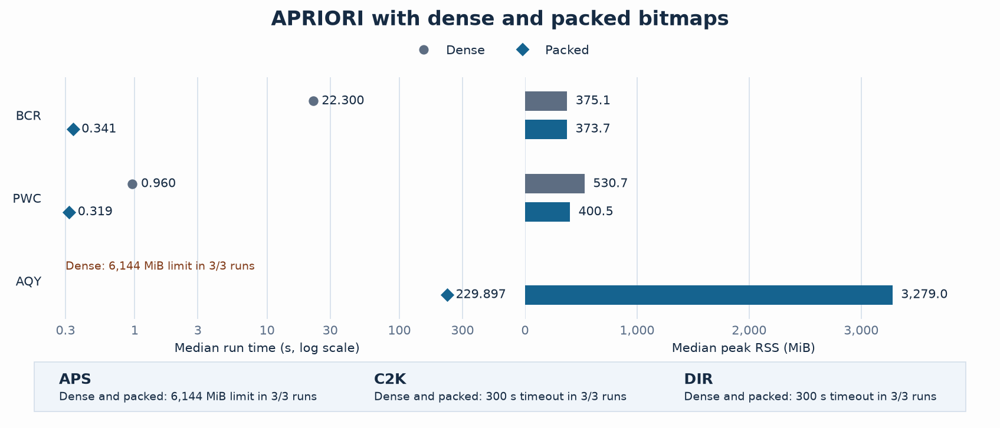
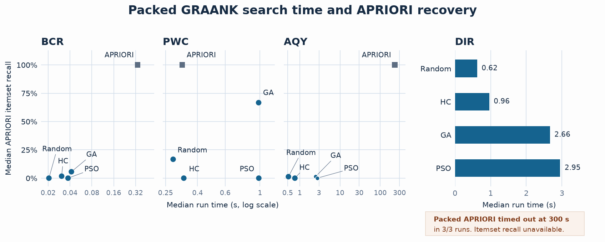

# GRAANK and TGRAANK optimization benchmark

For each dataset and seed, the selected searches use the same rows, features,
target, and support threshold.

| Method | Search types | GRAANK source | Bitmap representation |
| --- | --- | --- | --- |
| `dense` | `apriori`, `pso`, `ga`, `hc`, `random` | Git revision `affc7860397002fba26af96dcb2f0461f2cdda9d` | Dense `n × n` bitmaps |
| `packed` | `apriori`, `pso`, `ga`, `hc`, `random` | `from so4gp.algorithms import GRAANK` in the selected Python interpreter | Packed bits |

Each trial runs in its own subprocess. The dense worker imports from a verified
archive of the pinned revision in local Git history. The packed worker uses the
interpreter's normal import path. The dense-to-packed comparisons also
reflect other differences between the two source revisions.

## Data

The GRAANK experiment reads six CSVs in [`data/`](data/). Every trial records
the source and prepared-data hashes, selected columns, and retained rows.

| Dataset | File | Default target |
| --- | --- | --- |
| BCR | `breast_cancer.csv` | `Glucose` |
| C2K | `c2k.csv` | `o_dlv_e` |
| AQY | `air_quality.csv` | `CO(GT)` |
| DIR | `directio15k.csv` | `Hm0` |
| PWC | `power_consumption50k.csv` | `Global_active_power` |
| APS | `aps_16k.csv` | `aa_000` |

The loader selects numeric attributes, excludes labels and IDs, and handles
dataset-specific missing values using complete cases. It prepares the selected
data in memory and sends it directly to each worker. Use `--site` if the
Directio file contains multiple sites. The datasets originate from the
[source data directory](https://github.com/owuordickson/meso-hpc-lr/tree/master/hpc%40lr/data).

## Run

Use an interpreter with a packed-bit SO4GP install. To use this checkout's
package, run `python -m pip install -e .` from the repository root. The dense
revision must be present in local Git history when running GRAANK.

In PyCharm, run `benchmarks/optimization/benchmark.py` as a script with that
interpreter or use `benchmarks.optimization.benchmark` as the module name from
the repository root.

```powershell
python benchmarks/optimization/benchmark.py --datasets BCR --warmups 0
python -m benchmarks.optimization.benchmark --datasets BCR AQY --profile study --search-types apriori
python benchmarks/optimization/benchmark.py --datasets BCR --search-types pso ga hc random --iterations 20
```

For GRAANK, the default `study` profile uses up to 2,500 rows per dataset,
all usable numeric features, and seeds 0 through 2. It runs all five search
types in both layouts at minimum support 0.2, with one discarded warm-up
per trial, a 300-second timeout, and a best-effort memory limit of 6,144 MiB
per worker. The `full` profile uses the full prepared datasets and one seed.
The `quick` profile uses up to 64 rows, six features, and one seed.

Use `--search-types` to select searches. `--iterations` sets the heuristic
iteration budget and defaults to 10. `--apriori-level` sets an optional depth
limit for both APRIORI methods. Use `--rows`, `--features`, `--support`, `--target`,
and `--seeds` to define a workload.
`--memory-mib`, `--timeout`, and `--warmups` control the trial limits and warm-ups.

## GRAANK Results

Each run creates a folder under [`results/`](results/) with `manifest.json`,
`trials.jsonl`, `summary.csv`, and `paired_summary.csv`. The manifest records
the run settings and algorithm sources. The runner saves each trial as
it finishes and refreshes both CSVs at the end of each dataset.

The GRAANK summary lists each `search_type` and bitmap `method` separately.
The paired summary compares packed against dense for the same search.
When APRIORI is included, it also compares each heuristic with APRIORI
in the same layout.

| Metric | Definition |
| --- | --- |
| Elapsed time | Miner construction and the selected search |
| Peak resident memory | Sampled worker process-tree RSS in bytes and MiB, including imports and result collection |
| Valid patterns | Patterns returned by GRAANK |
| Invalid candidates | Candidate rejections recorded by GRAANK's `Invalid Count` |
| Time and memory ratios | Baseline divided by comparison, using completed trials with matching inputs and seeds |
| Itemset overlap | Jaccard index of returned patterns, treating a pattern and its global sign reversal as equivalent |
| APRIORI output recall | Fraction of baseline APRIORI itemsets recovered by the comparison |

The CSVs report medians from completed trials. Timeouts and memory limits appear
as trial statuses. When GRAANK has an empty search space, the trial completes
with zero patterns and records `empty_search_space: true`.

Resume a run with `--resume --output <same-run-folder>` and the original
options, source, and data. The runner rebuilds the CSVs from `trials.jsonl`,
skips saved trials, and retries any interrupted trial without a record.

### Dense and packed APRIORI

The saved study ran six datasets with a 2,500-row cap, three seeds, and a
10-iteration budget for each heuristic. The time and peak RSS columns show
the median for each completed method. Paired speedup is the median of the
dense-to-packed time ratios for matched seeds. [Run manifest](results/graank/manifest.json) · [Run summaries](results/graank/summary.csv) · [Paired summaries](results/graank/paired_summary.csv)

| Dataset | Rows × features | Dense time (s) or outcome | Packed time (s) or outcome | Paired speedup | Median peak RSS, dense → packed (MiB) |
| --- | ---: | ---: | ---: | ---: | ---: |
| BCR | 116 × 9 | 22.300 | 0.341 | 67.12× | 375.1 → 373.7 |
| PWC | 2,500 × 7 | 0.960 | 0.319 | 3.15× | 530.7 → 400.5 |
| AQY | 2,500 × 13 | 6,144 MiB limit (3/3) | 229.897 | — | — → 3,279.0 |
| C2K | 2,500 × 69 | 300 s timeout (3/3) | 300 s timeout (3/3) | — | — |
| DIR | 2,500 × 16 | 300 s timeout (3/3) | 300 s timeout (3/3) | — | — |
| APS | 2,500 × 170 | 6,144 MiB limit (3/3) | 6,144 MiB limit (3/3) | — | — |



BCR and PWC each had three completed pairs. Dense and packed APRIORI returned
the same itemsets in all six pairs after accounting for full sign reversals.
Packed APRIORI used about **25% less peak RSS** on PWC. Across the 17 completed
comparisons that used the same search on AQY, APS, C2K, DIR, and PWC, packed
peak RSS was 21–79% lower by paired medians. Packed had a paired speedup above
1× in 19 of the 22 completed comparisons with the search held fixed. On C2K,
both completed comparisons favored dense for run time, with paired speedups of
0.70× for packed hill climbing and 0.57× for packed random search. [Paired summaries](results/graank/paired_summary.csv)

Of the 180 trials, 135 completed, 12 timed out, and 9 hit the memory limit.
The remaining 24 trials were GA and PSO runs on C2K and APS. Both layouts
raised `OverflowError` while bounding candidate positions for these two
datasets. [Trial records](results/graank/trials.jsonl)

### Heuristic speed and pattern recovery

The table compares searches using packed bitmaps. Pattern and invalid candidate
counts are totals over the three seeds, and all returned patterns had reported
support of at least 0.2. APRIORI recall is the median fraction of its distinct
itemsets each search recovered at the same seed. [Run summaries](results/graank/summary.csv) · [Paired summaries](results/graank/paired_summary.csv)

| Dataset | Search | Median time (s) | Paired speedup vs. APRIORI | Returned patterns | Invalid candidates | APRIORI recall |
| --- | --- | ---: | ---: | ---: | ---: | ---: |
| BCR | APRIORI | 0.341 | 1.00× | 174 | 2,791 | 100.00% |
| BCR | Genetic algorithm (GA) | 0.042 | 3.36× | 23 | 41 | 5.66% |
| BCR | Hill climbing (HC) | 0.031 | 11.13× | 7 | 1 | 1.75% |
| BCR | Particle swarm optimization (PSO) | 0.038 | 4.66× | 2 | 100 | 0.00% |
| BCR | Random search | 0.020 | 16.23× | 9 | 9 | 0.00% |
| PWC | APRIORI | 0.319 | 1.00× | 21 | 124 | 100.00% |
| PWC | Genetic algorithm (GA) | 0.980 | 0.35× | 23 | 31 | 66.67% |
| PWC | Hill climbing (HC) | 0.327 | 1.16× | 4 | 0 | 0.00% |
| PWC | Particle swarm optimization (PSO) | 0.982 | 0.33× | 9 | 87 | 0.00% |
| PWC | Random search | 0.279 | 1.12× | 16 | 6 | 16.67% |
| AQY | APRIORI | 229.897 | 1.00× | 229 | 66,248 | 100.00% |
| AQY | Genetic algorithm (GA) | 2.469 | 92.99× | 26 | 34 | 1.37% |
| AQY | Hill climbing (HC) | 0.756 | 303.59× | 6 | 0 | 0.00% |
| AQY | Particle swarm optimization (PSO) | 2.705 | 84.88× | 3 | 0 | 0.00% |
| AQY | Random search | 0.523 | 438.89× | 11 | 4 | 1.32% |



On BCR, the four heuristic searches ran **3.36–16.23× faster** by paired
medians, with a highest median APRIORI recall of **5.66%**. PSO returned two
patterns and recorded 100 invalid candidates. On PWC, hill climbing and random
search had paired speedups above 1×. GA reached the highest heuristic recall
at **66.67%** and took about three times as long as APRIORI by paired medians.
On AQY, the heuristics ran **84.88–438.89× faster** by paired medians and
recovered at most **1.37%** of the APRIORI itemsets by median recall.

### DIR search results

All four DIR heuristic searches completed on all three seeds in each layout.
The paired speedup compares dense and packed versions of the same search.
Speedup against APRIORI and APRIORI recall require a completed APRIORI baseline.
[Run summaries](results/graank/summary.csv) · [Paired summaries](results/graank/paired_summary.csv)

| Search | Dense median time (s) | Packed median time (s) | Paired speedup | Median peak RSS, dense → packed (MiB) | Returned patterns, dense → packed | Invalid candidates, dense → packed |
| --- | ---: | ---: | ---: | ---: | ---: | ---: |
| GA | 7.135 | 2.664 | 2.68× | 678.2 → 411.7 | 18 → 25 | 19 → 56 |
| HC | 2.411 | 0.962 | 2.64× | 678.4 → 412.5 | 5 → 5 | 1 → 1 |
| PSO | 10.377 | 2.951 | 4.32× | 678.2 → 406.8 | 3 → 2 | 0 → 100 |
| Random search | 1.681 | 0.622 | 2.70× | 677.9 → 409.5 | 12 → 12 | 6 → 6 |

On DIR, the packed heuristics achieved **2.64–4.32× paired speedups** and used
about 39–40% less peak RSS by paired medians. Packed random search was fastest at
**0.622 s**. Packed GA returned the most patterns, and packed PSO recorded
the most invalid candidates.

## TGRAANK comparison on rainfall and EVI

The temporal experiment uses the notebook's rainfall and Enhanced Vegetation
Index (EVI) CSVs. Each file has 23 annual observations from 2000 through 2022,
with NRB, KAK, MAK, and WAJ as the four targets.

```powershell
python benchmarks/optimization/benchmark.py --experiment temporal --profile full --warmups 0 --output benchmarks/optimization/results/tgraank-replication
python benchmarks/optimization/tools/analyze_tgraank.py benchmarks/optimization/results/tgraank-replication
```

Use a fresh output directory for each replication and pass the same path to
the analysis helper. The saved runs are in [`results/tgraank`](results/tgraank/).

All three methods mine fuzzy temporal gradual patterns with minimum support
0.01 and initial minimum representativity 0.75. The worker calls SO4GP's
`TGrad` and `TGradAMI` engines with descriptors enabled. TGRAANK tests shifts
of one through five observations on each dataset (`all` in the benchmark).
TGRAANK-AMI estimates shifts on rainfall with an MI error margin of 0.00001
and reuses those shifts for the corresponding EVI target (`ami`).

TGRAANK-AMI (Random) draws one integer k-step per feature from 1 through 6
for each target (`random`). The runner uses
`42 * target_column_index + trial_seed` as the random seed for those draws
and applies them to both rainfall and EVI. With the default trial seed of 0,
the draws use the notebook's target-specific seeds.

The analysis uses rainfall as the prediction and EVI as the reference proxy.
It matches patterns once using SO4GP's temporal similarity rule, which compares
gradual items and signed, formatted time delays. After matching, support of
at least 0.5 counts as positive, and an unmatched pattern gets zero support on
the other side. Accuracy is the fraction of matched or unmatched entries
that are true positives or true negatives. The summary averages the per-site
scores and reports their sample standard deviations.

- [Per-site confusion counts and scores](results/tgraank/confusion_matrix.csv)
- [Mean and standard deviation by algorithm](results/tgraank/metrics_summary.csv)
- [Runtime and memory by target](results/tgraank/summary.csv)

### Replication results

The saved run completed 24 trials with SO4GP 1.1.2 and seed 0, one per
method, dataset, and site combination. The table sums confusion counts
across sites. The heatmaps show mean counts per site.
[Run manifest](results/tgraank/manifest.json) · [Per-site confusion counts](results/tgraank/confusion_matrix.csv)

| Method | True positives | False positives | False negatives | True negatives | Scored entries |
| --- | ---: | ---: | ---: | ---: | ---: |
| Classical TGRAANK | 34 | 26 | 26 | 229 | 315 |
| TGRAANK with random shifts | 6 | 4 | 6 | 47 | 63 |
| TGRAANK-AMI | 8 | 4 | 4 | 47 | 63 |


Scores are mean percentages ± sample standard deviation across the four
equally weighted sites. Each method supplies its own set of mined patterns
for scoring. [Metric summary](results/tgraank/metrics_summary.csv)

| Method | Accuracy (%) | Precision (%) | Recall (%) | Specificity (%) | F1 (%) |
| --- | ---: | ---: | ---: | ---: | ---: |
| Classical TGRAANK | 81.23 ± 9.26 | 56.46 ± 19.72 | 56.67 ± 20.73 | 87.65 ± 6.46 | 56.53 ± 20.17 |
| TGRAANK with random shifts | 79.54 ± 16.43 | 58.33 ± 28.87 | 50.00 ± 33.33 | 88.43 ± 12.12 | 53.33 ± 31.27 |
| TGRAANK-AMI | **84.18 ± 12.94** | **66.67 ± 27.22** | **66.67 ± 27.22** | **89.51 ± 8.62** | **66.67 ± 27.22** |


AMI had the highest mean on all five metrics. Its mean accuracy was
**2.95 percentage points above classical TGRAANK** and **4.64 points above
random shifts**. Mean F1 rose by 10.14 and 13.33 points, respectively.
Accuracy improved over classical at KAK, NRB, and WAJ. At MAK it fell
from 76.92% to 69.23%.
[Per-site scores](results/tgraank/confusion_matrix.csv)
