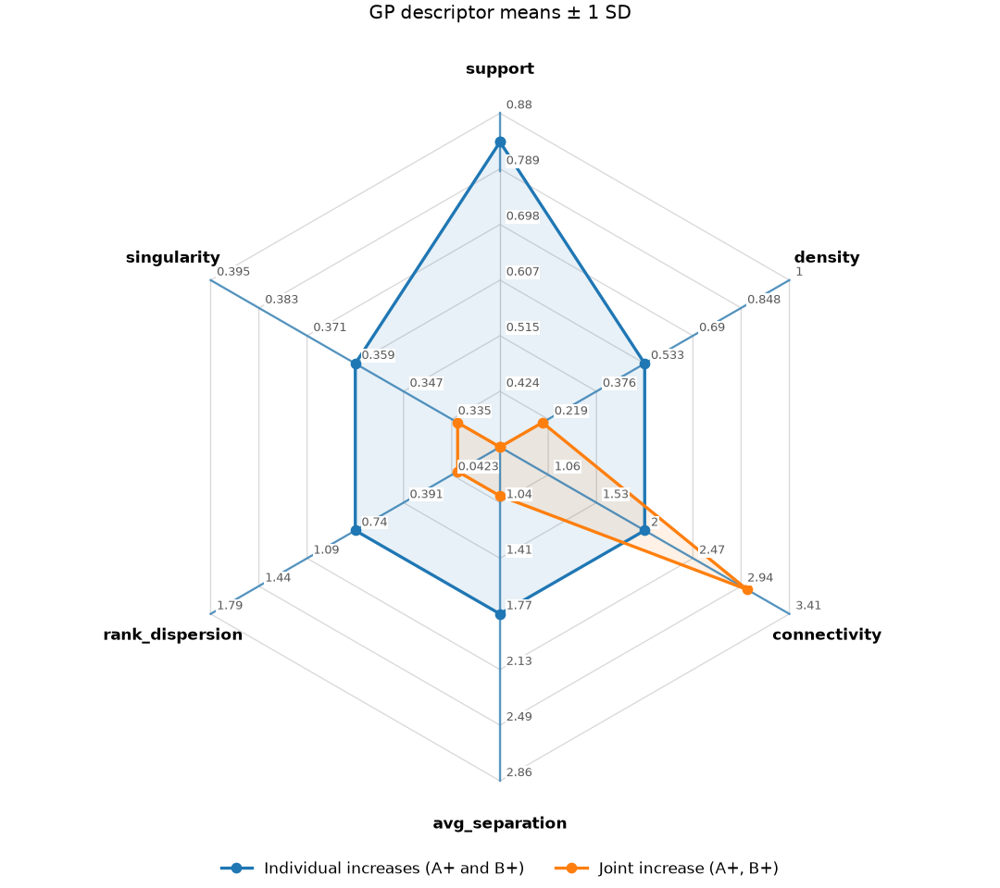

# Joint-effect features with GRAANK

A gradual item (GI) describes how one attribute changes between two ordered
observations. The item `A+` holds when the later observation has a higher
value of A, and `A-` holds when it has a lower value. A gradual pattern (GP)
combines items. The pattern `A+, B+` holds when both A and B increase between
the same two observations.

## Compare individual and joint changes

Use six ordered observations of A and B. Run the code blocks in order with
SO4GP installed.

```python
import matplotlib.pyplot as plt
import numpy as np
import pandas as pd

from so4gp import gp_spider_plot
from so4gp.algorithms import GRAANK

columns = ["A", "B"]
data = np.array([
    [0, 4], [2, 5], [1, 2],
    [4, 3], [3, 0], [5, 1],
], dtype=float)

items = GRAANK.build_gradual_features(data, column_names=columns, pattern_level=1)
joint = GRAANK.build_gradual_features(data, column_names=columns, pattern_level=2)

individual = items.loc[items["pattern"].isin(["A+", "B+"])]
together = joint.loc[joint["pattern"].isin(["A+, B+", "B+, A+"])]
comparison = pd.concat([individual, together], ignore_index=True)
print(comparison.round(3).to_string(index=False))
```

For a 2D array shaped `(observations, channels)`, the builder returns one
row per pattern. The pattern name is in the `pattern` column alongside the
six numeric descriptors. The items in a joint pattern can appear in either
order, so the filter accepts both spellings.

The comparison shows the descriptors rounded to three decimal places.

| Pattern | `support` | `density` | `connectivity` | `avg_separation` | `rank_dispersion` | `singularity` |
| --- | ---: | ---: | ---: | ---: | ---: | ---: |
| `A+` | 0.867 | 0.867 | 1 | 2.538 | 1.479 | 0.385 |
| `B+` | 0.800 | 0.200 | 3 | 1.000 | 0.000 | 0.333 |
| `A+, B+` | 0.333 | 0.200 | 3 | 1.000 | 0.000 | 0.333 |

## Read the descriptors

| Column | Meaning |
| --- | --- |
| `support` | Pair-support score used by GRAANK. It can count matches in reverse row order. |
| `density` | Fraction of all earlier–later pairs that satisfy the pattern in row order. |
| `connectivity` | Number of connected groups when each retained pair links two observations. Isolated observations count as groups. |
| `avg_separation` | Mean gap between paired rows, measured in observation steps. |
| `rank_dispersion` | Population variance of the gaps between paired rows. |
| `singularity` | Largest fraction of retained pairs that share a single observation. |

Of the 15 possible forward pairs, 13 satisfy `A+`. Only three satisfy
`B+`, and all three also satisfy `A+`. The joint pattern therefore retains
the same pairs as `B+`, at zero-based indices `(0, 1)`, `(2, 3)`, and
`(4, 5)`. That gives both rows density `0.2` and three connected groups.
Every pair spans one observation step, so the mean separation is `1` and
the rank dispersion is `0`. Each observation appears in exactly one of
the three retained pairs, so singularity is `1/3`.

Support uses a different count. For a GI, GRAANK uses the larger of the
forward increase and decrease counts. B decreases in 12 pairs, so `B+`
has support of `0.8`. The joint pattern matches three pairs in row order
and two in reverse row order, giving support of about `0.333`.

## Compare the profiles in a spider plot

Plot the same descriptors with the two individual items as one group and
the joint pattern as the other.

```python
descriptors = comparison.columns.drop("pattern").tolist()
figure = gp_spider_plot(
    [individual, together],
    ["Individual increases (A+ and B+)", "Joint increase (A+, B+)"],
    descriptors,
)
plt.show()
```

Each marker shows the group's mean on that descriptor. The bars show one
sample standard deviation around the mean for the two individual items.
The joint group has one row, so its markers show the joint values without
bars. Each spoke has its own scale. Compare the two markers on the same
spoke to see how the joint profile differs from the individual average.



## Options and your own data

Sort observations by time and pass finite numerical channels to the builder.
Keep dates and labels outside the feature array. Gaps measure steps between
rows. On irregularly sampled data, two equal gaps can represent different
amounts of elapsed time.

Use `pattern_level=1` for individual items and `2` for two-item patterns.
Higher levels control how far the miner combines items. For multi-item
patterns, a positive `max_patterns` caps the rows returned per recording
after mining, and `None` keeps all patterns found.

For a 3D array shaped `(recordings, observations, channels)`, the builder
adds a `recording` column and returns one row per recording and pattern.
For classification, pivot the descriptors into one row per recording and
align the test feature columns to the training columns. For that workflow
and a comparison of rainfall and EVI, see the
[worked notebook](https://github.com/owuordickson/gp-mining/blob/main/examples/joint_effect.ipynb).
